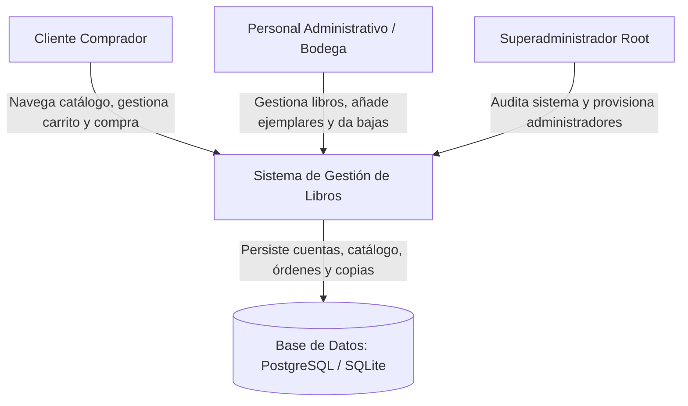
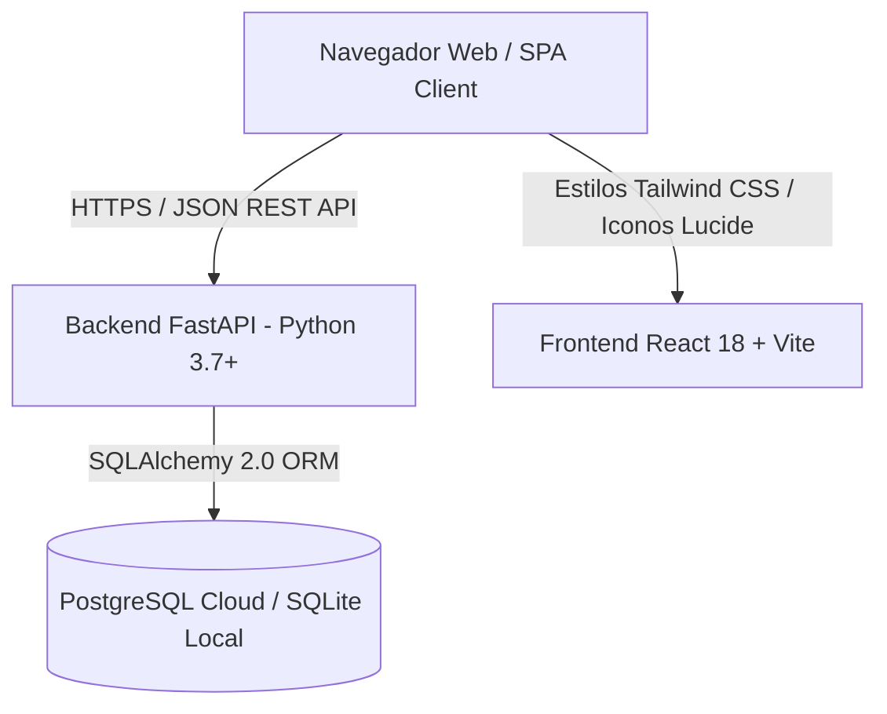
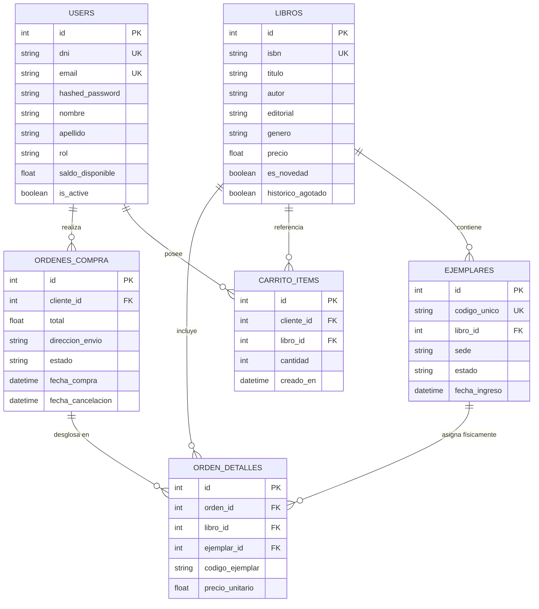

# 🏛️ Documentación Técnica Final del Sistema (Nota 4)
### Asignatura: IS873 — Laboratorio de Software (Semestre 2026-2)
**Universidad Tecnológica de Pereira (UTP) — Facultad de Ingenierías**  
**Programa:** Ingeniería de Sistemas y Computación  
**Evaluación:** Nota 4 de 4 (Entrega Final del Producto — Peso: 30% de la calificación final)  
**Fecha de Entrega Única:** 1 de diciembre de 2026, 6:00 p. m.

---

### 👥 Equipo de Desarrollo:
* **Jose David Marín Giraldo** (`josedavid.marin@utp.edu.co`) — *Backend Architect & Database Lead*
* **Edwin Osorio Cartagena** — *Frontend Engineer & UI/UX Specialist*
* **Maicol Londoño Hernández** — *QA & DevOps / Automated Testing Lead*

---

## 1. 🌐 Resumen Ejecutivo del Producto
El **Sistema de Gestión y Compra de Libros en Línea** es una solución web empresarial desarrollada para resolver el problema de sobreventa de libros, pérdida de trazabilidad física por copia y falta de auditoría en librerías tradicionales. 

A diferencia de los carritos de compras convencionales basados en inventarios numéricos agregados, este sistema introduce:
1. **Control granular por copia física única (`EJEMPLAR`):** Cada unidad física tiene un código único de barras (`LIB-XXX-EJYYY`), una sede física asignada y un ciclo de vida trazable (`DISPONIBLE`, `VENDIDO`, `DADO_DE_BAJA`).
2. **Carrito persistente sin bloqueo temprano:** Los usuarios pueden conservar libros en su carrito de compras sin amarrar stock; la deducción física se realiza exclusivamente en el momento del checkout.
3. **Checkout Atómico con Billetera Virtual (Todo o Nada):** En el instante en que el usuario compra, una transacción ACID verifica la existencia de stock físico suficiente para todos los libros solicitados. Si otro cliente compró el último ejemplar en ese intervalo, el checkout es rechazado con HTTP 409 Conflict, sin debitar saldo de la billetera.
4. **Seguridad RBAC Estricta:** Cuatro roles tipados (`VISITANTE`, `CLIENTE`, `ADMINISTRADOR`, `ROOT`), con aplicación inviolable de la regla de negocio **RF-031**, la cual prohíbe de forma determinista que cuentas administrativas compren o reserven libros.

---

## 2. 🏗️ Arquitectura del Sistema (Modelo C4)

### 2.1. Nivel 1: Diagrama de Contexto del Sistema


### 2.2. Nivel 2: Diagrama de Contenedores


### 2.3. Diagrama Entidad-Relación (ERD) de Base de Datos


---

## 3. 🚀 Instrucciones de Instalación y Ejecución en Entorno Local

El sistema está diseñado para iniciar de punta a punta en cualquier máquina Windows o Linux con un solo comando.

### Requisitos Previos:
* Python 3.7 o superior instalado.
* Node.js 18 o superior con `npm`.
* Puerto 8000 libre para el backend FastAPI.
* Puerto 5173 libre para el frontend Vite React.

### Arranque Automático en Windows:
En la raíz del proyecto, ejecuta el script por lotes:
```cmd
start_project.bat
```
Este script:
1. Detecta o inicializa el entorno virtual de Python en `backend/venv`.
2. Instala dependencias si no están presentes (`pip install -r requirements.txt`).
3. Inicializa las tablas y datos semilla de prueba (`python -m app.db.init_db`).
4. Inicia el servidor FastAPI en `http://localhost:8000`.
5. Inicia el servidor de desarrollo Vite en `http://localhost:5173`.
6. Abre automáticamente el navegador web en la aplicación.

### Cuentas Semilla Preconfiguradas:
* **Superadministrador Root:** `root@libreria.com` / `RootSecure2026!` (Rol: `ROOT`)
* **Administrador Demo:** `admin.bodega@libreria.com` / `Admin2026!` (Rol: `ADMINISTRADOR`)
* **Cliente Demo:** `cliente.demo@gmail.com` / `Cliente2026!` (Rol: `CLIENTE`, Saldo inicial: $150.000 COP)

### Ejecución de Pruebas Automatizadas:
```cmd
python run_tests.py
```
O directamente con `pytest`:
```cmd
backend\venv\Scripts\pytest tests -v
```

---

## 4. 📊 Backlog Consolidado del Producto y Estado Final de Cada Historia

| ID | Historia de Usuario | Sprint | Estimación | Estado Final | Criterio de Verificación |
| :--- | :--- | :---: | :---: | :---: | :--- |
| **HU-01** | Registro de nuevos clientes con DNI y email únicos (RF-027) | Sprint 1 | 5 SP | **COMPLETADA** | Validado en `test_sprint1_auth_rbac.py` |
| **HU-02** | Creación exclusiva de Administradores por Root (RF-030) | Sprint 1 | 5 SP | **COMPLETADA** | Validado en `test_sprint1_auth_rbac.py` |
| **HU-03** | Restricción estricta de compra a roles administrativos (RF-031) | Sprint 1 | 2 SP | **COMPLETADA** | Validado en `test_sprint1_auth_rbac.py` |
| **HU-04** | Autenticación con Token Bearer JWT y roles tipados (RF-026) | Sprint 1 | 3 SP | **COMPLETADA** | Validado en `test_sprint1_auth_rbac.py` |
| **HU-05** | Cierre de sesión y desvinculación local de credenciales | Sprint 1 | 1 SP | **COMPLETADA** | Validado en frontend y backend |
| **HU-06** | Cambio seguro de contraseña con verificación previa (RF-028) | Sprint 1 | 2 SP | **COMPLETADA** | Validado en `/auth/change-password` |
| **HU-07** | Consulta y actualización de datos de perfil y despacho (RF-021) | Sprint 1 | 3 SP | **COMPLETADA** | Validado en `ProfilePage.tsx` |
| **HU-08** | Catálogo bibliográfico con filtros y stock en vivo (RF-008) | Sprint 2 | 5 SP | **COMPLETADA** | Validado en `HomePage.tsx` y test suite |
| **HU-09** | Carrito de compras persistente sin reserva previa (RF-012) | Sprint 2 | 5 SP | **COMPLETADA** | Validado en `CartPage.tsx` y test suite |
| **HU-10** | Checkout atómico con Billetera Virtual y concurrencia (RF-013) | Sprint 2 | 8 SP | **COMPLETADA** | Validado en `test_sprint2_catalog_cart_checkout.py` |
| **HU-11** | Historial de órdenes y cancelación con reembolso (RF-014) | Sprint 2 | 5 SP | **COMPLETADA** | Validado en `OrdersPage.tsx` y test suite |
| **HU-12** | Gestión de inventario físico y bajas de ejemplares (RF-002, 004) | Sprint 2 | 5 SP | **COMPLETADA** | Validado en `InventoryAdminPage.tsx` |
| **HU-13** | Recarga y consulta de saldo de Billetera Virtual (RF-037) | Sprint 2 | 3 SP | **COMPLETADA** | Validado en `ProfilePage.tsx` y endpoints |
| *HU-POST* | Reservas físicas a 24 horas con worker Celery asíncrono | Post-MVP | 8 SP | *POSPUESTA* | Evaluada en PoC técnica Nota 1 |
| *HU-POST* | Pasarela de pagos bancaria externa (PSE / Stripe) | Post-MVP | 5 SP | *POSPUESTA* | Reemplazada por Billetera Virtual (RF-037) |
| *HU-POST* | Mapa interactivo de rutas de despacho con Google Maps API | Post-MVP | 5 SP | *POSPUESTA* | Alcance no crítico para venta de libros |

---

## 5. 💡 Decisiones de Diseño Relevantes Tomadas Durante el Semestre

1. **Decisión 1: Estrategia de Concurrencia en Carrito y Stock (Semestre 2026-2):**
   * *Alternativa Evaluada:* Bloquear ejemplares físicos durante 30 minutos desde el momento en que se agregan al carrito.
   * *Problema Identificado:* Genera ataques de denegación de inventario donde usuarios maliciosos llenan carritos sin intención de compra, vaciando el stock para otros compradores legítimos.
   * *Decisión Adoptada:* **Carrito Persistente sin Bloqueo Temprano + Verificación Atómica en Checkout (Todo o Nada).** Los ejemplares solo se asignan y pasan a `VENDIDO` al procesar el pago. Si al comprar ya no hay stock suficiente, la transacción se aborta con HTTP 409 Conflict sin tocar el saldo del cliente.
2. **Decisión 2: Trazabilidad Física por Ejemplar (RF-002) vs Conteo Numérico Clásico:**
   * *Decisión Adoptada:* Modelar la entidad `BookCopy` (`ejemplar`) con código único generado según la fórmula `LIB-{id:03d}-EJ{idx:03d}`. Esto permite saber con exactitud física qué copia física específica se vendió, en qué sede estaba y cuál fue dada de baja por deterioro.
3. **Decisión 3: Arquitectura Multi-Base de Datos (Híbrida Cloud & Local):**
   * *Decisión Adoptada:* El backend soporta fluidamente SQLite para ejecución local autónoma sin requerir servidores externos (`start_project.bat`), y PostgreSQL sobre Supabase para entornos de despliegue en la nube, configurado mediante variable de entorno `DATABASE_URL`.
4. **Decisión 4: Billetera Virtual Nativa (RF-037):**
   * *Decisión Adoptada:* Para evitar depender de sandbox bancarios inestables o credenciales de pasarelas de pago externas, se implementó la Billetera Virtual nativa con saldo recargable, garantizando transacciones seguras, inmediatas y cancelaciones con reembolso atómico.
