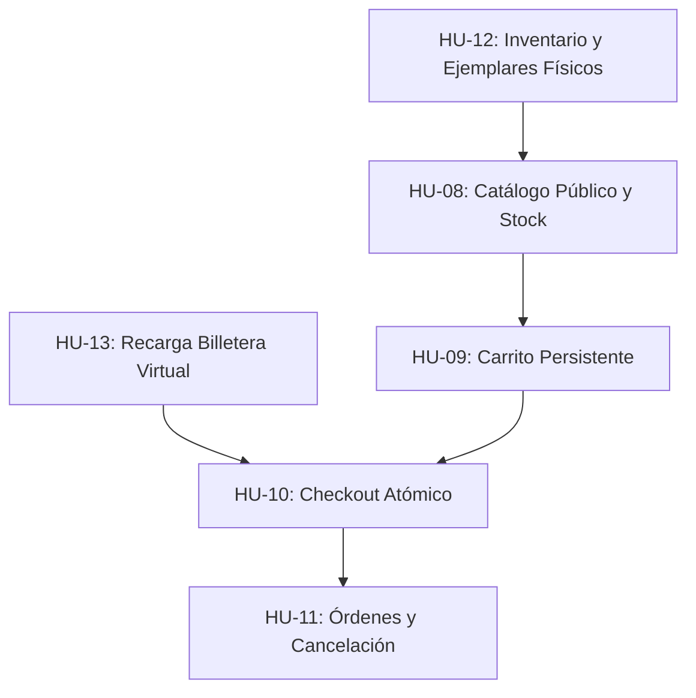

# 📋 Documento de Sprint Planning 2 — Segundo Incremento Funcional (Nota 3)
### Asignatura: IS873 — Laboratorio de Software (Semestre 2026-2)
**Universidad Tecnológica de Pereira (UTP) — Facultad de Ingenierías**  
**Programa:** Ingeniería de Sistemas y Computación  
**Evaluación:** Nota 3 de 4 (Sprint Review 2 — Peso: 20% de la calificación final)  
**Fecha de Entrega:** 1 de diciembre de 2026, 6:00 p. m.

---

### 👥 Equipo de Desarrollo y Distribución de Roles:
* **Jose David Marín Giraldo** (`josedavid.marin@utp.edu.co`) — *Backend Architect & Concurrency Specialist*
* **Edwin Osorio Cartagena** — *Frontend Lead & Catalog / Wallet Developer*
* **Maicol Londoño Hernández** — *Inventory & QA / Automated Testing Specialist*

---

## 1. 🎯 Sprint Goal 2
> *"Construir e integrar el flujo de valor comercial del sistema sobre el núcleo de seguridad y RBAC de la Nota 2: catálogo con búsqueda y disponibilidad en tiempo real, carrito de compras persistente por usuario, checkout atómico con Billetera Virtual y control estricto de concurrencia ante stock agotado (Todo o Nada), trazabilidad por código físico único de ejemplar (LIB-XXX-EJYYY) y cancelación con reembolso inmediato, respaldado por una suite automatizada de pruebas y manual de usuario bilingüe."*

---

## 2. 📊 Capacidad del Equipo y Velocidad Estimada
* **Duración del Sprint:** ~3 semanas (del 10 de noviembre al 1 de diciembre de 2026).
* **Integrantes Activos:** 3 desarrolladores a dedicación parcial académica (~15 horas/semana por integrante).
* **Capacidad Total en Horas:** $3 \times 3 \times 15 = 135$ horas hombre de ingeniería.
* **Velocidad Histórica (Sprint 1):** 21 Story Points completados y sustentados.
* **Capacidad Comprometida para Sprint 2:** **31 Story Points** (ajustado al incremento funcional ampliado exigido en la Nota 3).

---

## 3. 📝 Historias de Usuario Comprometidas en el Sprint 2

| ID | Historia de Usuario | Requisitos Asociados | Prioridad MoSCoW | Estimación (SP) | Responsable Principal |
| :--- | :--- | :--- | :---: | :---: | :--- |
| **HU-08** | Catálogo bibliográfico interactivo y buscador en tiempo real | RF-001, RF-007, RF-008 | **MUST HAVE** | 5 SP | Edwin Osorio |
| **HU-09** | Carrito de compras persistente sin reserva anticipada de stock | RF-009, RF-011, RF-012 | **MUST HAVE** | 5 SP | Jose David Marín |
| **HU-10** | Checkout atómico con Billetera Virtual y control de concurrencia | RF-013, RF-037 | **MUST HAVE** | 8 SP | Jose David Marín |
| **HU-11** | Historial de órdenes de compra y cancelación con reembolso de saldo | RF-014, RF-015, RF-022 | **SHOULD HAVE** | 5 SP | Maicol Londoño |
| **HU-12** | Gestión administrativa de inventario físico (altas, bajas y copias) | RF-002, RF-004, RF-005, RF-006 | **MUST HAVE** | 5 SP | Maicol Londoño |
| **HU-13** | Consulta y recarga de saldo en Billetera Virtual del cliente | RF-037 | **MUST HAVE** | 3 SP | Edwin Osorio |
| **TOTAL** | **6 Historias de Usuario Comprometidas** | **Sprint 2** | — | **31 SP** | **Equipo Completo** |

---

## 4. ⚖️ Justificación de Cada Historia Comprometida y Dependencias Técnicas

### 4.1. Justificación por Capacidad y Prioridad
1. **HU-08 (Catálogo Público - 5 SP):** Es la puerta de entrada al producto. Sin un catálogo dinámico que consulte en tiempo real la disponibilidad de ejemplares físicos, los clientes no pueden descubrir títulos ni iniciar el embudo de compra.
2. **HU-09 (Carrito Persistente - 5 SP):** Implementa el requerimiento ajustado del cliente: los libros se mantienen en el carrito indefinidamente y no se apartan físicamente hasta el checkout. Se aplica la restricción de máximo 3 unidades por título.
3. **HU-10 (Checkout Atómico y Billetera Virtual - 8 SP):** Es el corazón transaccional del sistema. Requiere atomicidad estricta (ACID): si dos clientes compiten por el último ejemplar, el primero en confirmar compra adquiere el ejemplar y al segundo se le rechaza la transacción con HTTP 409 Conflict, sin debitar dinero.
4. **HU-11 (Historial y Cancelación - 5 SP):** Cierra el ciclo de servicio al cliente. Si un pedido está en preparación y el cliente desiste, el sistema reintegra el saldo y retorna los ejemplares a `DISPONIBLE`.
5. **HU-12 (Inventario Físico - 5 SP):** Garantiza que los Administradores puedan registrar libros, asociarles nuevos ejemplares físicos y dar de baja ejemplares deteriorados o extraviados (RF-004).
6. **HU-13 (Billetera Virtual - 3 SP):** Provee el medio de pago nativo exigido en la especificación (RF-037), permitiendo a los clientes abonar saldo para comprar.

### 4.2. Matriz de Dependencias Técnicas

---

## 5. 🚫 Historias que Quedaron Fuera del Sprint y Por Qué
1. **Reserva física a 24 horas con expiración asíncrona (Celery/Redis worker):**
   * *Motivo de Exclusión:* En la Nota 1 se validó la PoC técnica de expiración asíncrona. Sin embargo, para este incremento, la prioridad del negocio fue el flujo comercial directo con Billetera Virtual y control de concurrencia en checkout. Las reservas de 24h se reservan para etapas posteriores de escalamiento.
2. **Integración con pasarela externa bancaria (PSE / Tarjeta de Crédito Stripe):**
   * *Motivo de Exclusión:* El alcance y las reglas de negocio de la asignatura establecieron como medio de pago oficial la **Billetera Virtual / Monedero** del usuario (RF-037). Integrar una pasarela externa requeriría ambientes sandbox financieros y contratos bancarios fuera del alcance pedagógico.
3. **Georreferenciación de envíos mediante Google Maps API:**
   * *Motivo de Exclusión:* Aunque se planificó la estructura para direcciones de despacho (RF-021), la integración visual del mapa se consideró no bloqueante frente a la completitud transaccional y las pruebas unitarias exigidas en la Nota 3.

---

## 6. 🔍 Criterios de Aceptación por Historia de Usuario (Formato Gherkin)

### HU-08: Catálogo Bibliográfico y Stock en Tiempo Real
* **Escenario 1 (Búsqueda exitosa):**
  * *Dado* que un usuario visitante o autenticado accede a `/libros?q=Clean`,
  * *Cuando* el sistema procesa la consulta,
  * *Entonces* retorna una lista de libros cuyo título, autor o ISBN coincida parcialmente con "Clean", mostrando el conteo de copias en estado `DISPONIBLE`.
* **Escenario 2 (Filtro por género):**
  * *Dado* que se solicita `/libros?genero=Software`,
  * *Cuando* el servidor filtra los títulos,
  * *Entonces* solo retorna libros categorizados bajo "Ingeniería de Software".

### HU-09: Carrito de Compras Persistente
* **Escenario 1 (Adición sin bloqueo de copias):**
  * *Dado* que un cliente autenticado agrega 1 unidad del libro ID 1 a su carrito,
  * *Cuando* se consulta el stock del libro en el catálogo,
  * *Entonces* el stock físico sigue apareciendo idéntico (no se aparta ningún ejemplar en esta fase).
* **Escenario 2 (Tope de 3 unidades por título):**
  * *Dado* que un cliente intenta agregar 4 unidades de un mismo título,
  * *Cuando* el servidor valida la solicitud,
  * *Entonces* trunca la cantidad a un máximo de 3 unidades (regla de negocio del proyecto).

### HU-10: Checkout Atómico con Billetera Virtual y Concurrencia
* **Escenario 1 (Compra exitosa):**
  * *Dado* que el cliente tiene en su carrito libros con stock suficiente y su saldo cubre el total,
  * *Cuando* confirma el checkout en `POST /compras/checkout`,
  * *Entonces* se debita el total de su billetera virtual, se crea la orden en estado `EN_PREPARACION`, se asignan los primeros ejemplares `DISPONIBLE` en orden FIFO cambiándolos a `VENDIDO`, y el carrito queda vacío.
* **Escenario 2 (Conflicto de concurrencia por stock agotado — Todo o Nada):**
  * *Dado* que un cliente tiene un libro en su carrito y otro usuario compró el último ejemplar disponible antes de que este finalice,
  * *Cuando* el cliente presiona "Pagar con Billetera Virtual",
  * *Entonces* la transacción se aborta con HTTP 409 Conflict, NO se debita dinero de su billetera, y se notifica: *"El ejemplar del libro [Título] se encuentra agotado o con stock insuficiente."*
* **Escenario 3 (Saldo insuficiente):**
  * *Dado* que el total del carrito supera el saldo disponible del cliente,
  * *Cuando* intenta comprar,
  * *Entonces* el sistema rechaza la operación con HTTP 400 Bad Request indicando el faltante.

### HU-11: Cancelación de Orden y Reembolso
* **Escenario 1 (Cancelación permitida):**
  * *Dado* que una orden se encuentra en estado `EN_PREPARACION`,
  * *Cuando* el cliente solicita su cancelación (`POST /compras/ordenes/{id}/cancelar`),
  * *Entonces* el estado pasa a `CANCELADA`, el monto total se reintegra a la Billetera Virtual del cliente y los ejemplares físicos vinculados vuelven al estado `DISPONIBLE`.
* **Escenario 2 (Cancelación denegada en estados avanzados):**
  * *Dado* que una orden se encuentra en `ENVIADO` o `ENTREGADO`,
  * *Cuando* el cliente intenta cancelarla,
  * *Entonces* el servidor retorna HTTP 400 Bad Request indicando que no se permite anular órdenes despachadas.

### HU-12: Inventario Físico de Ejemplares
* **Escenario 1 (Generación de código único de ejemplar):**
  * *Dado* que un Administrador registra un libro con 3 ejemplares iniciales,
  * *Cuando* la base de datos almacena el registro,
  * *Entonces* genera automáticamente los códigos `LIB-{id:03d}-EJ001`, `LIB-{id:03d}-EJ002` y `LIB-{id:03d}-EJ003`.
* **Escenario 2 (Baja de ejemplar y bandera Histórico Agotado):**
  * *Dado* que un ejemplar se da de baja con `PATCH /libros/ejemplares/{id}/dar-de-baja`,
  * *Cuando* dicho ejemplar era el último disponible del título,
  * *Entonces* el libro actualiza automáticamente su bandera `historico_agotado = True` (RF-006).

---

## 7. 🏁 Definition of Done (DoD) del Equipo
Para que una Historia de Usuario se considere **TERMINADA** en este sprint, debe satisfacer obligatoriamente los siguientes 6 pilares:
1. **Código Integrado:** Funcionalidad implementada y fusionada en la rama principal `main` sin conflictos.
2. **Persistencia y Modelado:** Modelos ORM y migraciones ejecutadas correctamente tanto en SQLite local como en PostgreSQL Supabase.
3. **Pruebas Automatizadas (Nota 3):** Cobertura con pruebas unitarias y de integración en `/tests`, ejecutándose al 100% de éxito con `python run_tests.py` o `pytest`.
4. **Demostración de Fallo Intencional:** Verificación operativa del script `tests/test_intentional_failure_demo.py` demostrando tanto el fallo controlado como el éxito de la aserción.
5. **Interfaz de Usuario (Frontend):** Vistas responsivas en React/TypeScript compilando limpiamente con `npm run build` sin errores de tipado.
6. **Trazabilidad y Documentación:** Documentación técnica actualizada, cuaderno Jupyter `demo_sprint2.ipynb` ejecutable y manual de usuario bilingüe con capturas reales.
